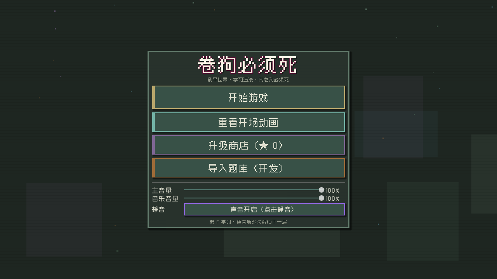

# 卷狗必须死（JuanGou Must Die）

一款 Godot 4 制作的像素风校园潜行 + 答题生存游戏：在“内卷违法”的荒诞校园里，避开同学、老师和暴君，找座位刷学习值，答题续命，活到过关。

**在线试玩（Web 版）：<https://juangoumustdie.vercel.app>**



## 玩法

- 关卡制：从大厅出发，在随机拼接的教学楼里寻找学习点，把学习值刷到 100 即可过关。
- 答题是主要成长手段：答题时世界继续流动，答题进度会保留；答对回复空虚值并累积火热连击。
- 空虚值归零即失败；被发现会累积警告，警告满 3 次本关失败。
- 五关逐步加入卷狗同学、任课老师、巡逻保安和暴君；暴君出现后会掉落烟雾弹、折叠椅、臭气弹等对抗道具。
- 支持本地存档、关卡星级、学段解锁和开发者版题库导入。

## 操作

| 操作 | 按键 |
| --- | --- |
| 移动 | `WASD` / 方向键 |
| 冲刺 | `Shift` |
| 互动 / 坐下答题 | `E` |
| 学习 / 复习 | `F` |
| 使用道具 1 / 2 / 3 | `R` / `T` / `Y`（也可点击 HUD） |
| 暂停 / 返回 | `Esc` |
| 过场翻页 | `回车` / `空格` / 鼠标左键 |
| 跳过整段过场 | `Esc` |

> Web 版需要键盘与鼠标，建议使用桌面浏览器。

## 本地运行

1. 安装 **Godot 4.7.2**（标准版，非 .NET）。
2. 用 Godot 导入本目录的 `project.godot`，按 `F5` 运行。
3. 首次打开若提示导入资源，等待导入完成即可。

Windows 下也可以直接运行仓库内的启动脚本。

## 测试

```powershell
$G = "E:\computerProgram2\tools\godot-4.7.2\Godot_v4.7.2-stable_win64.exe"

& $G --headless --path . --quit-after 4000 res://tests/flow_test.tscn
& $G --headless --path . --quit-after 8000 res://tests/_stalkerprobe.tscn
& $G --headless --path . --quit-after 8000 res://tests/student_test.tscn
```

画面回归：

```powershell
Start-Process -FilePath $G -ArgumentList '--path','.','res://tests/screenshot.tscn' -Wait
```

截图输出在 `tests/shot_*.png`。

## Web 构建与 Vercel 部署

Web 导出产物已提交在 `export/web/`，Vercel 通过 `vercel.json` 的 `outputDirectory` 直接托管该目录。

重新构建：

```powershell
$env:GODOT = "E:\computerProgram2\tools\godot-4.7.2\Godot_v4.7.2-stable_win64.exe"
powershell -ExecutionPolicy Bypass -File tools/build_web.ps1
```

部署：

```powershell
vercel --prod
```

`export_presets.cfg` 中的 Web 预设使用 **GL Compatibility**、关闭线程支持，因此无需额外的跨域隔离也能运行；`vercel.json` 仍保留 COOP/COEP 头，便于以后开启线程。

## 目录结构

- `scripts/`：游戏逻辑（主流程、玩家、暴君、学生、地图、答题、UI、存档、音频）。
- `scenes/`：Godot 场景。
- `assets/`：美术、音乐、字体等素材。
- `data/`：题库 JSON。
- `tests/`：自动化流程测试与截图回归。
- `tools/`：构建与美术辅助脚本。
- `export/web/`：Web 导出产物（Vercel 托管目录）。

## 素材与致谢

音乐与第三方素材的授权信息见 [`assets/music/CREDITS.txt`](assets/music/CREDITS.txt)。引擎为 [Godot Engine](https://godotengine.org/)。
